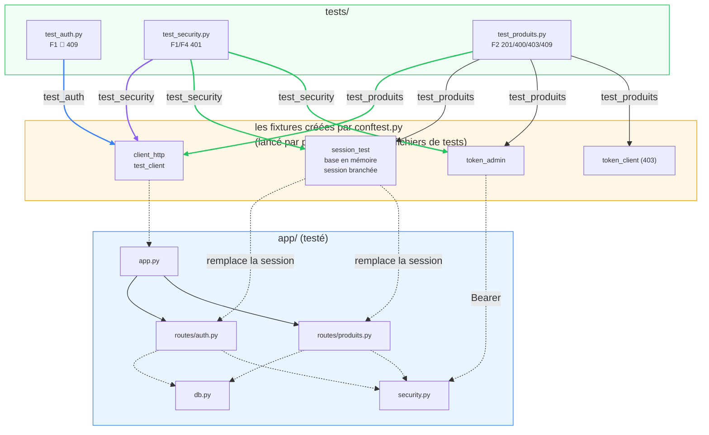

# ÉTAPE 5 appliquée à DigiMarket — NIVEAU 🥇 CONFIRMÉ (conception des tests)

⏱️ **~1 h — moyenne** (niveau 🥇 : matrice complète + régression).

**Principe** : on conçoit les tests à partir de **ce qui a été créé en étape 4 🥇** (`etape4-confirme.md`), pas avant.
**Règle du test** : un test = **une fonction/classe testée + UN scénario + le résultat attendu**, avec un **nom explicite**.

## Matrice élément × type de test (niveau 🥇 = complète, avec régression)

> Règles de remplissage (convention étape 4) : 1ʳᵉ colonne **Fonction métier**, 2ᵉ **Objet(s)** ; ✅ = test prévu ; « — » = pas de ce type pour cet élément.
> Au 🥇 on ajoute la colonne **Régression** (tout rejoué automatiquement à chaque modification).

| Fonction métier | Objet(s) | Élément testé (étape 4 🥇) | Unitaire | Intégration (route+base+sécurité) | Scénario | Résultat attendu | Nom du fichier |
|---|---|---|---|---|---|---|---|
| **F1+F4** (auth) | `User` → token | `POST /api/auth/login` | — | ✅ (🥈) | bon/mauvais mdp | 200+token / 401 | `tests/test_security.py` |
| **F4** | token (4.2) | `creer_token/verifier_token` | ✅ (🥈) | ✅ (🥈) | token truqué/expiré | 401 | `tests/test_security.py` |
| **F2** (+F4) | `Product`, `Category` | CRUD `/api/produits`, `/api/categories` | ✅ (🥈) | ✅ (🥈) | admin/sans token/prix<0/doublon | 201/401/403/400/409 | `tests/test_produits.py` |
| **F3** (🥇) | `Order` + `OrderItem` | `POST /api/commandes` | — | ✅ `test_creer_commande_201`, `test_stock_insuffisant_400`, `test_quantite_zero_400`, `test_sans_token_401` | client connecté passe commande / stock insuffisant / qté=0 / sans token | 201 / 400 / 400 / 401 | `tests/test_commandes.py` |
| **F3+F4** (🥇) | `Order` | `GET /api/commandes`, `/<id>`, `/<id>/lignes` | — | ✅ `test_liste_mes_commandes`, `test_commande_autre_client_403`, `test_commande_inexistante_404` | client voit ses commandes / lit celle d'un autre / id inconnu | 200 / 403 / 404 | `tests/test_commandes.py` |
| **F3+F4** (🥇) | `Order.statut` | `PATCH /api/commandes/<id>/statut` | — | ✅ `test_patch_admin_valide_200`, `test_patch_client_proprietaire_annule_200`, `test_patch_transition_interdite_400`, `test_patch_client_non_proprietaire_403` | admin valide / client_propriétaire annule / transition interdite / autre client | 200 / 200 / 400 / 403 | `tests/test_commandes.py` |
| **F3** (🥇) | `Product` | effet de bord stock (validation/annulation) | ✅ `test_stock_decremente_a_validation`, `test_stock_restitue_a_annulation` | ✅ (via PATCH) | valider décrémente, annuler restitue | stock -qté / +qté | `tests/test_commandes.py` |
| **F3** (🥇) | `Order` | `changer_statut` (transitions 4.6) | ✅ `test_transition_autorisee`, `test_transition_interdite` | — | en_attente→validée OK ; expédiée→annulée KO | statut changé / ValueError→400 | `tests/test_commandes.py` |
| **F3** (🥇) | `Order`, `OrderItem` | `calculer_total` (4.9, fonction pure) | ✅ `test_calculer_total` | — | 2 lignes (2×10€ + 1×5€) | total = 25 | `tests/test_commandes.py` |
| **F3** (🥇) | `Product` | `verifier_stock` (4.9, fonction pure) | ✅ `test_verifier_stock_ok`, `test_verifier_stock_insuffisant` | — | stock suffisant / insuffisant | True / lève 400 | `tests/test_commandes.py` |
| **F1–F4** (tout) | toutes les tables | **régression** (🥇) | — | ✅ `pytest` tout rejoué à chaque incrément | lancer toute la suite | tout vert | `tests/` (tout) |

### Récap — tests prévus par fonction métier (F1/F2/F3 séparés de F4 sécurité)

- **F1** comptes (🥉+🥈) : `tests/test_auth.py`, `tests/test_security.py` (login) ;
- **F2** catalogue (🥈) : `tests/test_produits.py` ;
- **F3** commandes (🥇) : `tests/test_commandes.py` — unitaires (transitions 4.6, `calculer_total` 4.9, stock) + intégration (POST 201/400/401, GET 200/403/404, PATCH 200/400/403) ;
- **F4** sécurité (🥈+🥇) : `tests/test_security.py` — tokens 401, admin_required 403, **client_propriétaire-ou-admin** sur commandes ;
- **Régression 🥇** : `pytest` lance tout (14 tests 🥉/🥈 + ~12 tests 🥇), rejoué à chaque incrément.

---

✅ **Checklist étape 5 (niveau 🥇)** :
- [x] chaque fonction/classe créée a au moins un test unitaire prévu (matrice) : Order.changer_statut, calculer_total, verifier_stock, stock ;
- [x] chaque route a son test d'intégration avec codes : POST 201/400/401 · GET 200/403/404 · PATCH 200/400/403 ;
- [ ] régression prévue (tout rejoué) ;
- [ ] chaque test a un nom explicite (scénario + résultat attendu) + son fichier ;
- [ ] README « Comment tester » à jour (`pytest`).

🧵 **Fil rouge 🥇** : « passer une commande » → `test_creer_commande_201` (POST /api/commandes → 201) puis `test_patch_admin_valide_200` (PATCH statut → 200, stock décrémenté).

❓ **Auto-évaluation** : 1) Différence unitaire / intégration / régression ? 2) Pourquoi la règle client_propriétaire a-t-elle son test 403 ? 3) Pourquoi la régression n'existe qu'au 🥇 ?

📝 **À retenir (3 lignes)** : 1) Un test = 1 élément + 1 scénario + 1 résultat attendu, nommé, avec son fichier. 2) 🥇 = matrice complète + régression. 3) Les tests se conçoivent APRÈS l'étape 4, et se jouent à chaque incrément (étape 6).

*Conception des tests 🥇 prête. Prochaine étape (avec validation) : étape 6 niveau 🥇 — `docs/etape6-backlog-confirme.md` (backlog 🥇, à valider AVANT le code).*

---

## 🎨 Canva des interactions entre les tests (voir aussi `docs/canva-tests.mmd`)

### Descriptif écrit

## Rôle de `conftest.py`
pytest le charge **avant tous les fichiers de tests**. Il définit 4 fixtures communes :

- `session_test` — crée une base SQLite **en mémoire** (`sqlite:///:memory:`), y branche la session dans `routes/auth.py` et `routes/produits.py` (elle **remplace** celle de `db.py` liée à la vraie `digimarket.db`) ;
- `client_http` — `app.test_client()`, le « curl simulé » de Flask (appelle les routes sans serveur) ;
- `token_admin` / `token_client` — créent un compte en base de test, appellent `POST /api/auth/login`, renvoient le token JWT.

## Qui demande quoi (code couleur des flèches dans le canva)

| Couleur | Fichier de test | Demande |
|---|---|---|
| 🔵 bleu | `test_auth.py` (F1 🥉, 409) | → `client_http` |
| 🟣 violet | `test_security.py` (F1 login + F4 tokens 401) | → `client_http` + `session_test` + `token_admin` |
| 🟢 vert | `test_produits.py` (F2 CRUD 201/400/401/403/409) | → `client_http` + `session_test` + `token_admin` + `token_client` (pour tester le 403) |

## Côté app testé
`client_http` appelle `app/app.py`, qui dispatche vers `routes/auth.py` et `routes/produits.py` ; celles-ci utilisent la **session de test** (jamais la vraie base) et passent par `security.py` (`creer_token`/`verifier_token`/`admin_required`) — les tokens vont en header `Authorization: Bearer <token>`.

👉 **L'essentiel** : les tests sont isolés (base en mémoire, jetable à chaque test) et ne touchent **jamais** `digimarket.db`.

