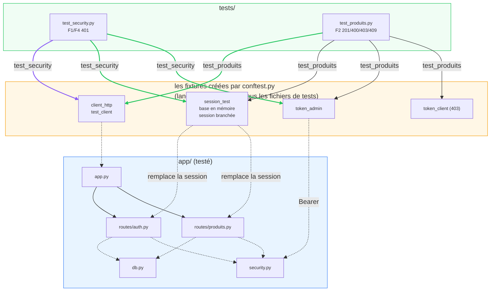

# ÉTAPE 5 appliquée à DigiMarket — NIVEAU 🥈 INTERMÉDIAIRE (conception des tests)

**Principe** : tests conçus à partir de l'étape 4 niveau 🥈 (`etape4-intermediaire.md`).
**Niveau 🥈 = test unitaire pour chaque fonction/classe + premiers tests d'intégration (route + base + sécurité).**
F3 (commandes) n'est PAS testée ici (réservée au 🥇).

## Matrice élément × type de test (niveau 🥈)

> 💡 **À quoi sert cette matrice ?** Elle croise chaque **élément créé à l'étape 4**
> (colonne « Élément testé ») avec les **types de test** possibles (unitaire / intégration),
> pour ne rien oublier. Règles de remplissage :
> - 1ʳᵉ colonne **Fonction métier**, 2ᵉ **Objet(s)** (convention étape 4) ;
> - ✅ = test prévu ; « — » = pas de test de ce type pour cet élément ;
> - unitaire = on teste la fonction/classe seule (sans route) ; intégration = on teste
>   la route complète (requête HTTP → base → réponse, y compris la sécurité 401/403).

| Fonction métier | Objet(s) | Élément testé (étape 4 🥈) | Unitaire | Intégration (route+base+sécurité) | Scénario | Résultat attendu | Nom du fichier |
|---|---|---|---|---|---|---|---|
| **F1+F4** (auth) | `User` → token | `POST /api/auth/login` | — | ✅ `test_login_ok_renvoie_token`, `test_login_mauvais_mot_de_passe_401` | login avec bon/mauvais mdp | 200 + token / 401 | `tests/test_security.py` |
| **F4** | token (donnée temporaire, 4.2) | `security.creer_token / verifier_token` | ✅ `test_token_invalide_401`, `test_token_expire_401` | ✅ (via login) | token truqué ou expiré en header | 401 | `tests/test_security.py` |
| **F2** (+F4) | `Product`, `Category` | CRUD `/api/produits` | — | ✅ `test_creer_produit_sans_token_401`, `test_creer_produit_client_403`, `test_creer_produit_admin_201`, `test_creer_produit_prix_negatif_400` | POST produit sans token / avec token client / admin valide / prix<0 | 401 / 403 / 201 / 400 | `tests/test_produits.py` |
| **F2** (+F4) | `Category` | `POST /api/categories` (création catégorie) | ✅ `test_categorie_objet_attributs` | ✅ `test_creer_categorie_admin_201`, `test_categorie_nom_unique_409`, `test_categorie_sans_token_401` | POST catégorie admin / doublon / sans token | 201 / 409 / 401 (objet : attributs OK) | `tests/test_produits.py` |
| **F2** | `Product` | `GET /api/produits` (public, recherche) | — | ✅ `test_liste_produits_avec_recherche` | GET /api/produits?q=pc avec 2 produits | 200 + seul le produit « PC » | `tests/test_produits.py` |

### Récap — tests prévus par fonction métier (F1 / F2 séparés de F4 sécurité)

**F1 — Gérer les comptes** (auth) :

| Test | Vérifie | Code |
|---|---|---|
| `test_login_ok_renvoie_token` | login OK → token JWT émis | 200 |
| `test_login_mauvais_mot_de_passe_401` | mauvais mot de passe | 401 |

**F2 — Gérer le catalogue** (produits + catégories) :

| Test | Vérifie | Code |
|---|---|---|
| `test_creer_produit_admin_201` | création produit (admin) | 201 |
| `test_creer_produit_sans_token_401` | route protégée sans token | 401 |
| `test_creer_produit_client_403` | token client sur route admin | 403 |
| `test_creer_produit_prix_negatif_400` | contrainte 4.3 : prix >= 0 | 400 |
| `test_liste_produits_avec_recherche` | GET public + recherche `?q=` | 200 |
| `test_creer_categorie_admin_201` | création catégorie (admin) | 201 |
| `test_categorie_nom_unique_409` | contrainte 4.3 : nom catégorie unique | 409 |
| `test_categorie_sans_token_401` | route catégories sans token | 401 |
| `test_categorie_objet_attributs` (unitaire) | objet `Category` : id, name, products | — |

**F4 — Sécuriser les accès** (séparé des F1/F2 : c'est du contrôle d'accès, pas de la logique métier) :

| Test | Vérifie | Code |
|---|---|---|
| `test_token_invalide_401` | token truqué | 401 |
| `test_token_expire_401` | token expiré | 401 |

## Les tests (extraits, avec commentaires)

### Les fixtures communes (niveau 🥈) — extraits de `tests/conftest.py`

```python
# tests/conftest.py — pytest le charge AVANT tous les fichiers de tests

@pytest.fixture
def session_test():
    """Base SQLite EN MÉMOIRE + session branchée dans les routes (auth.py, produits.py).
    → la vraie base digimarket.db n'est JAMAIS touchée par les tests."""
    engine = create_engine("sqlite:///:memory:")   # base en RAM, jetable
    Base.metadata.create_all(engine)                # crée users, categories, products
    S = sessionmaker(bind=engine)()
    auth_module.session = S                         # « poignée » : on remplace la session
    prod_module.session = S                         #   de db.py par celle-ci dans les routes
    yield S
    Base.metadata.drop_all(engine)                  # nettoyage après le test

@pytest.fixture
def client_http(session_test):
    """Client HTTP de test : app.test_client() = curl simulé (appelle les routes sans serveur)."""
    app.config["TESTING"] = True
    yield app.test_client()

@pytest.fixture
def token_admin(client_http, session_test):
    """Token JWT d'un ADMIN : crée l'admin en base de test, login, renvoie le token."""
    ...  # POST /api/auth/login → {"token": ...}
    return token

@pytest.fixture
def token_client(client_http, session_test):
    """Token JWT d'un CLIENT (rôle 'client') → sert à tester le 403 (rôle insuffisant)."""
    ...
```

> 💡 Mécanisme clé : les routes font `from app.db import session` (elles utilisent la variable `session`).
> En faisant `auth_module.session = S`, on **redirige** cette variable vers la base en mémoire :
> toutes les opérations des routes passent par la base de TEST, jamais par `digimarket.db`.


```python
# ============================================================
# CATÉGORIE F1 — Gérer les comptes (authentification) → fichier : tests/test_security.py
# ============================================================
def test_login_ok_renvoie_token(client_http, session_test):
    # Un user existe en base (fixture) → login renvoie 200 + un token JWT
    r = client_http.post("/api/auth/login", json={"email": "a@b.c", "password": "secret"})
    assert r.status_code == 200
    assert "token" in r.get_json()          # le token est bien présent dans la réponse

def test_login_mauvais_mot_de_passe_401(client_http):
    r = client_http.post("/api/auth/login", json={"email": "a@b.c", "password": "faux"})
    assert r.status_code == 401             # mauvais identifiants → 401

# ============================================================
# CATÉGORIE F4 — Sécuriser les accès (401/403, séparé de F1/F2) → fichier : tests/test_security.py
# ============================================================
def test_token_invalide_401(client_http):
    # Token truqué (signature invalide) → 401
    r = client_http.post("/api/produits", json={"name": "PC"},
                         headers={"Authorization": "Bearer <token_truque>"})
    assert r.status_code == 401

def test_token_expire_401(client_http):
    # Token signé avec une date d'expiration passée → 401 (expiré)
    r = client_http.post("/api/produits", json={"name": "PC"},
                         headers={"Authorization": "Bearer <token_expire>"})
    assert r.status_code == 401

# ============================================================
# CATÉGORIE F2 — Gérer le catalogue (produits + catégories) → fichier : tests/test_produits.py
# ============================================================
def test_creer_produit_sans_token_401(client_http):
    # Sans header Authorization → le décorateur login_required renvoie 401
    r = client_http.post("/api/produits", json={"name": "PC", "price": 999, "stock": 5, "category_id": 1})
    assert r.status_code == 401

def test_creer_produit_client_non_admin_403(client_http, token_client):
    # Token valide mais rôle "client" → admin_required renvoie 403
    r = client_http.post("/api/produits", json={...},
                         headers={"Authorization": f"Bearer {token_client}"})
    assert r.status_code == 403

def test_creer_produit_admin_201(client_http, token_admin):
    # Token admin → création OK → 201
    r = client_http.post("/api/produits", json={"name": "PC", "price": 999, "stock": 5, "category_id": 1},
                         headers={"Authorization": f"Bearer {token_admin}"})
    assert r.status_code == 201

def test_creer_produit_prix_negatif_400(client_http, token_admin):
    # 4.3 : validation prix >= 0 → 400
    r = client_http.post("/api/produits", json={"name": "X", "price": -5, "stock": 1, "category_id": 1},
                         headers={"Authorization": f"Bearer {token_admin}"})
    assert r.status_code == 400

# (test de la transition d'état Order.valider(), partie 4.6, au niveau 🥇 avec F3 — pas ici)
# (F3 « Gérer les commandes » : PAS de tests ici — réservé au niveau 🥇)
def test_categorie_objet_attributs():
    c = Category(name="Informatique")
    assert c.name == "Informatique"
    assert hasattr(c, "products")          # relation 1—N (4.5)

def test_creer_categorie_admin_201(client_http, token_admin):
    r = client_http.post("/api/categories", json={"name": "Informatique"},
                         headers={"Authorization": f"Bearer {token_admin}"})
    assert r.status_code == 201

def test_categorie_nom_unique_409(client_http, token_admin):
    # 4.3 : unicité du nom de catégorie → 2e création = 409
    client_http.post("/api/categories", json={"name": "Info"}, headers={"Authorization": f"Bearer {token_admin}"})
    r = client_http.post("/api/categories", json={"name": "Info"}, headers={"Authorization": f"Bearer {token_admin}"})
    assert r.status_code == 409

def test_categorie_sans_token_401(client_http):
    r = client_http.post("/api/categories", json={"name": "Info"})
    assert r.status_code == 401

def test_liste_produits_avec_recherche(client_http, token_admin):
    # 2 produits créés, puis recherche ?q=pc → seul le PC remonté
    client_http.post("/api/produits", json={"name": "PC portable", "price": 999, "stock": 5, "category_id": 1}, headers={"Authorization": f"Bearer {token_admin}"})
    client_http.post("/api/produits", json={"name": "Clavier", "price": 49, "stock": 20, "category_id": 1}, headers={"Authorization": f"Bearer {token_admin}"})
    r = client_http.get("/api/produits?q=pc")
    assert r.status_code == 200
    assert len(r.get_json()) == 1 and "PC" in r.get_json()[0]["name"]

```

💡 **Règle du test** : 1 élément + 1 scénario + résultat attendu, nom explicite (`test_creer_produit_sans_token_401`).

---

✅ **Checklist étape 5 (niveau 🥈)** :
- [x] test unitaire pour chaque fonction/classe 🥈 (token) ; (transition 4.6 → niveau 🥇 avec F3)
- [x] tests d'intégration route + base + sécurité (login, 401/403, CRUD produits, validation 400) ;
- [x] matrice élément × type à jour ;
- [x] README « Comment tester » à jour (`pytest` lance tout).

🧰 **Bonnes pratiques** : test = partie de la DoD · `pytest` à chaque incrément · commit.

🧵 **Fil rouge 🥈** : « se connecter » (login → token) et « créer un produit en admin » (201, sinon 401/403).

❓ **Auto-évaluation** : 1) Différence unitaire / intégration ? 2) Pourquoi 401 vs 403 ? 3) Pourquoi F3 n'est pas testée ici ?

📝 **À retenir (3 lignes)** : 1) 🥈 = unitaires par élément + intégration avec sécurité. 2) 401 = pas authentifié, 403 = pas le bon rôle. 3) On teste APRÈS l'étape 4, à chaque incrément.

---
*Conception des tests 🥈 prête. Prochaine étape (avec validation) : étape 6 niveau 🥈 — backlog puis code (security.py, login, produits).*

---

## 🎨 Canva des tests de ce niveau (`docs/canva-tests-intermediaire.mmd`)



### Descriptif écrit

`conftest.py` (chargé par pytest avant tout) fournit : `session_test` (base en mémoire, session branchée dans auth.py/produits.py), `client_http` (test_client = curl simulé), `token_admin`, `token_client`.

| Couleur | Fichier (niveau 🥈) | Demande |
|---|---|---|
| 🟣 violet | `test_security.py` (F1 login + F4 tokens 401) | client_http + session_test + token_admin |
| 🟢 vert | `test_produits.py` (F2 CRUD 201/400/401/403/409) | client_http + session_test + token_admin + token_client (403) |

(Le test 🥉 `test_auth.py` est retiré de ce canva — voir `docs/canva-tests-debutant.mmd`.)
Côté app : `client_http` → `app/app.py` → routes → `security.py` (Bearer). Tests isolés : jamais `digimarket.db`.

