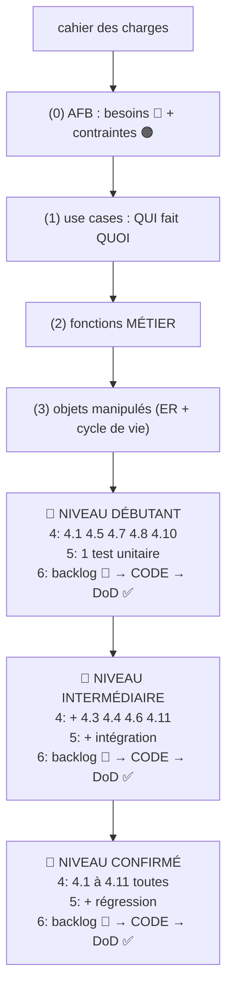

# Méthodologie de préparation (avant de coder) — étapes 0 à 6

> **Changelog** — v1.0 : première version (étapes 0–6). v1.1 : niveaux 🥉🥈🥇 dès l'étape 4 ; bonnes pratiques intégrées dans chaque étape ; glossaire, schéma Mermaid, Definition of Ready, signaux d'alerte. v1.2 : pédagogie — fil rouge concret, analogies, auto-évaluation (3 questions/étape), « à retenir en 3 lignes », temps estimés, pré-requis, faux bons résultats.

> ⚠️ **Ne pas confondre** : les *étapes du projet* (dans `attentes.md` : 1 = utilisateurs/auth, 2 = produits, 3 = commandes) ≠ les *étapes de la méthode* (0–6, dans ce fichier). Correspondance : niveau 🥉 = **F1 Gérer les comptes** (figé), 🥈 = **F2 Gérer le catalogue + F4 Sécuriser les accès**, 🥇 = **F3 Gérer les commandes** (étapes projet 1/2/3).

## Pré-requis (à savoir avant de commencer)
- **Python de base** : variables, fonctions, classes, `import` ;
- **HTTP de base** : requête/réponse, méthodes (GET, POST…), JSON ;
- **Git de base** : commit, push ;
- si un pré-requis manque → le réviser AVANT, pas pendant.

**Règle d'or** : on répond aux questions **dans cet ordre**, et chaque étape produit le matériau de la suivante. **À chaque étape : on remplit la checklist avant de passer à la suivante.**

**Rappel de vocabulaire** :
- **FONCTION MÉTIER = ACTION** (verbe + complément) : « gérer les comptes », « passer une commande ».
- **OBJET = CHOSE** (nom) : `Commande`, `Produit` — avec des **attributs** (données) et parfois un **état**.
- **La fonction métier agit sur l'objet** : la fonction métier « changer le statut » fait passer l'objet `Commande` de l'état `en_attente` à `validée`.

**Deux sortes de « fonction » à ne pas confondre** :
- la **fonction MÉTIER** = action globale du système (les blocs F1–F4 du diagramme fonctionnel) ;
- la **fonction PYTHON** = petit bloc de code qui transforme des données **sans garder d'état entre les appels** (fonction « pure »).

**Transversal — à toute étape** :
- 📓 **Carnet de bord** : 2 lignes par étape — « compris » / « bloque ».
- 🔗 **Traçabilité** : chaque élément vient d'une étape précédente — on n'invente rien.
- ✅ **Checklist de validation** avant de passer à l'étape suivante.
- 📌 **Definition of Ready** : avant de commencer une étape, le livrable de l'étape précédente doit exister **et être commité**.
- 🚨 **Signaux d'alerte** : bloqué plus de ~20-30 min sur une étape → relire l'exemple ou demander de l'aide. C'est normal.
- 🧰 **Bonnes pratiques** propres à chaque étape : indiquées en clair sous chaque étape.
- 🧵 **Fil rouge** : à chaque étape, on suit UN exemple concret de bout en bout : *« un utilisateur s'inscrit »*.
- 📖 **Relecture systématique** : avant de commencer CHAQUE étape, relire ENTIER son descriptif (question, outil, sortie, checklist ✅, piège ⚠️, 🧰 bonnes pratiques, 🧵 fil rouge) — ne jamais commencer une étape « de mémoire ».
- 🧰 **README à jour** : à chaque étape, vérifier que la section correspondante du README est remplie (étape 1 = Fonctionnalités, étape 4 = Structure, étape 5 = Comment tester, étape 6 = install/lancement/doc API).
- 🗺️ **Canva de la structure à jour** : quand la structure des fichiers change (README « Structure du projet »), mettre à jour AUSSI le canva `docs/canva-structure-*.mmd` — **un canva par niveau, jamais écrasé** : `canva-structure-debutant.mmd`, puis `-intermediaire.mmd`, puis `-confirme.mmd`.

---

## ÉTAPE 0 — AFB : Analyse fonctionnelle du besoin
⏱️ **~30 min — facile**

**Question** : quels sont les besoins bruts exprimés dans le cahier des charges ?
**Outil** : une simple **liste de phrases en français** — pas de diagramme à ce stade.
**Méthode** : relire le CDC ligne par ligne, noter chaque besoin tel quel.
- 🔵 **Besoin** = ce que veut l'utilisateur. 🟠 **Contrainte imposée** = technologie, délai… (les distinguer).
**Exemple de besoin brut** : « l'utilisateur s'inscrit avec une adresse unique », « le stock diminue quand une commande est validée ».
👉 **Sortie** : liste numérotée de besoins (contraintes séparées).

✅ **Checklist étape 0** :
- [ ] chaque besoin tient en une seule phrase ;
- [ ] aucun besoin ne contient déjà une solution technique (ex. « en Flask » = contrainte 🟠, pas un besoin 🔵).

⚠️ **Piège à éviter** : sauter cette étape et coder directement.

🧰 **Bonnes pratiques à ce stade** (le strict nécessaire uniquement) :
- créer le dépôt Git (public, avec README) et y déposer les fichiers de l'étape 0 → **1er commit** ;
- noter les conventions de nommage dans le README (`snake_case`, `PascalCase`, routes au pluriel).

*Le reste est transféré : `.gitignore` se crée en même temps que le dépôt ; `venv` + `requirements.txt` → étape 6, juste avant le 1er code (niveau 🥉) ; `.env` pour les secrets (clé JWT) → étape 6, niveau 🥈 quand la sécurité (4.11) arrive.*

🧵 **Fil rouge** : le besoin suivi est « l'utilisateur s'inscrire avec une adresse unique » 🔵.
❓ **Auto-évaluation** : 1) Citez un besoin et une contrainte du CDC. 2) Pourquoi séparer les deux ? 3) Que risque-t-on si on saute cette étape ?
📝 **À retenir (3 lignes)** : 1) Un besoin = une phrase, ce que veut l'utilisateur. 2) Une contrainte = imposé (techno, délai). 3) On ne code jamais avant d'avoir cette liste.

## ÉTAPE 1 — Use cases : cas d'utilisation
⏱️ **~45 min — facile**

**Question** : à partir de la liste de l'étape 0, **QUI** sont les acteurs et **QUOI** veulent-ils faire ?
**Outil** : **diagramme de cas d'utilisation** (bonhomme + bulles) **+ matrice des rôles** (rôle × ressource).
**Méthode** : repérer les acteurs, puis les cas (toujours un **verbe à l'infinitif**).
**Rappel** : un **acteur = un rôle joué**, pas une personne (analogie : un rôle dans une pièce de théâtre).
**Exemple** : acteurs Visiteur / Client / Admin ; cas « S'inscrire », « Consulter le catalogue », « Passer une commande »…
👉 **Sortie** : diagramme de cas + matrice des droits.

✅ **Checklist étape 1** :
- [ ] chaque besoin de l'étape 0 est couvert par **au moins un cas** (matrice besoins ↔ cas) ;
- [ ] chaque cas = un verbe à l'infinitif ;
- [ ] la matrice des rôles est complète (une croix par cas).

⚠️ **Pièges** : oublier les cas publics (Visiteur) ; donner tous les droits à tout le monde.

🧰 **Bonnes pratiques à ce stade** :
- commencer la matrice de traçabilité (besoin → cas) ;
- remplir le README : section « Fonctionnalités » = liste des cas d'utilisation ;
- faire un commit Git pour cette étape (message clair).

🧵 **Fil rouge** : l'acteur **Visiteur** a le cas **« S'inscrire »**.
❓ **Auto-évaluation** : 1) Pourquoi un acteur est-il un rôle et pas une personne ? 2) Citez un cas public. 3) À quoi sert la matrice des rôles ?
📝 **À retenir (3 lignes)** : 1) Acteur = rôle joué devant le système. 2) Cas = verbe à l'infinitif. 3) Chaque besoin doit être couvert par un cas.

## ÉTAPE 2 — Fonctions MÉTIER du système
⏱️ **~1 h — moyenne**

**Question** : quelles **ACTIONS globales internes** (fonctions métier) réalisent les cas de l'étape 1 ?
Deux outils, dans cet ordre :
1. **Diagramme fonctionnel** (blocs d'actions + flux) : une **fonction métier** par bloc — ex. F1 « Gérer les comptes »…
2. **Diagramme de flux** (flowchart + losanges) pour **UNE seule** fonction métier complexe : étapes et décisions.
**Test du « une phrase »** : on doit pouvoir dire en une phrase ce que fait chaque fonction métier.
👉 **Sortie** : les fonctions métier du système + le détail d'une fonction complexe.

✅ **Checklist étape 2** :
- [ ] chaque fonction métier réalise au moins un cas de l'étape 1 (traçabilité) ;
- [ ] chaque fonction métier tient en une phrase.

⚠️ **Piège** : confondre fonction métier (F1 « Gérer les comptes ») et fonction Python (voir vocabulaire).

🧰 **Bonnes pratiques à ce stade** :
- poursuivre la traçabilité (cas → fonction métier) ;
- commit Git de l'étape 2 (message clair).

🧵 **Fil rouge** : le cas « S'inscrire » est réalisé par la fonction métier **F1 « Gérer les comptes »** ; son flux : données valides ? email unique ? → créer le compte / sinon erreur 409.
❓ **Auto-évaluation** : 1) Quelle fonction métier réalise « S'inscrire » ? 2) Fonction métier ou fonction Python : quelle différence ? 3) Pourquoi ne détailler qu'UN seul flux ?
📝 **À retenir (3 lignes)** : 1) Fonction métier = action globale (F1–F4), tient en une phrase. 2) Le flux détaille UNE fonction complexe. 3) Fonction Python ≠ fonction métier.

## ÉTAPE 3 — Objets manipulés par les fonctions métier
⏱️ **~1 h — moyenne**

**Question** : quels **OBJETS** sont créés/manipulés, avec quels liens et quels états ?
**Rappel** : un **objet** = une **chose** avec des **attributs** (données) et peut-être un **état**. La fonction métier agit sur l'objet.
Deux outils :
1. **Modèle de données (schéma ER)** : objets + liens — ex. Utilisateur 1—N Commandes. Dans le schéma ER, chaque attribut a un rôle : **PK** (clé primaire, id unique), **FK** (clé étrangère, lien 1—N vers une autre table), **UK** (valeur unique, ex. email).
2. **Cycle de vie (state diagram)** : pour chaque objet à états, les états et **quelle fonction métier déclenche chaque transition**.
**Question clé par objet** : *« cet objet doit-il être persisté ? »* (analogie : cahier = persisté, brouillon jetable = temporaire) — prépare le 4.1.
👉 **Sortie** : liste des objets avec attributs, liens, états.

✅ **Checklist étape 3** :
- [ ] chaque objet vient d'une fonction métier de l'étape 2 ;
- [ ] pour chaque objet : persisté ou temporaire ? (réponse notée) ;
- [ ] pour chaque transition : la fonction métier qui la déclenche est notée.

⚠️ **Piège** : créer des objets « au cas où », ou oublier l'état d'un objet qui en a un.

🧰 **Bonnes pratiques à ce stade** :
- tenir à jour la **« structure du projet »** dans le README : liste des fichiers créés jusqu'à cette étape (étape 3 incluse) ;
- commit Git de l'étape 3 (message clair).

🧵 **Fil rouge** : l'objet **Utilisateur** est créé par F1 ; attributs : email (unique), mot de passe (haché), nom… ; **persisté** (cahier) ; pas de cycle de vie.
❓ **Auto-évaluation** : 1) Utilisateur est-il persisté ou temporaire ? Pourquoi ? 2) Citez un objet avec un état. 3) Qui déclenche chaque transition d'état ?
📝 **À retenir (3 lignes)** : 1) Objet = chose avec attributs et peut-être un état. 2) Persisté → ira en base (4.1). 3) La fonction métier agit sur l'objet.

---

## BOUCLE PAR NIVEAU — à répéter 3 fois (🥉 → 🥈 → 🥇)

Les étapes 0 à 3 viennent d'être faites **une seule fois, globalement**. À partir d'ici, on exécute les étapes 4, 5, 6 **en boucle, une fois par niveau** :

```
┌─ NIVEAU 🥉 DÉBUTANT ─────────────────────────────┐
│ étape 4 (parties 🥉) → étape 5 (tests 🥉) → étape 6   │
│ → backlog 🥉 → CODE de l'incrément → DoD ✅            │
└────────────────────────────────────────────────────┘
        │  le code 🥉 reste fonctionnel
        ▼
┌─ NIVEAU 🥈 INTERMÉDIAIRE ── même boucle, parties 🥈 ──┐
└────────────────────────────────────────────────────────┘
        ▼
┌─ NIVEAU 🥇 CONFIRMÉ ──────── même boucle, tout ────────┐
└────────────────────────────────────────────────────────┘
```

### Règle de répartition par complexité (quoi va dans quel niveau)

| Complexité | Niveau |
|---|---|
| Fonction métier SANS changement d'état, 1 objet simple, 1 route (ex. F1 comptes) | 🥉 débutant |
| Objet avec **relation 1—N** (clé étrangère), CRUD protégé par rôle, sécurité de base (JWT, hachage, .env) | 🥈 intermédiaire |
| Fonction métier **AVEC changement d'état** (cycle de vie, transitions), plusieurs relations entre objets, logique complexe (stock, totaux, historique) | 🥇 confirmé |

**Règle** : on ne passe au niveau suivant que quand le niveau courant respecte sa **Definition of Done** (code ✅ + test ✅ + doc ✅ + commit ✅). Le code d'un niveau **reste fonctionnel** quand on ajoute le suivant.

> Les étapes 4, 5, 6 ci-dessous sont les **références** : à chaque boucle, on applique la version du niveau courant (voir leurs tableaux de niveaux).

---

## ÉTAPE 4 — ANALYSE DE CONCEPTION *(appelée une fois par niveau, avec les parties de ce niveau)*
⏱️ **~2 h — difficile** (au total, sur les 3 niveaux)

**Principe** : on croise les résultats des étapes 1, 2 et 3. Règle à dire à voix haute : *« analyse → condition → si positif, ACTION de création »*, et *« si la condition est fausse, que se passe-t-il ? »*.

**Consignes de présentation du fichier `etape4-<niveau>.md`** (appliqué à chaque niveau) :
1. Commencer le fichier par un **tableau récap** : Fonction métier | Objet(s) | Routes | Fichiers à créer ;
2. Dans **tous les tableaux** du chapitre (récap, 4.3, 4.4, 4.7…), les deux premières colonnes sont **Fonction métier** puis **Objet(s)** ;
3. Un objet/fonction avec **relation 1—N** → niveau 🥈 ; avec **changement d'état (transitions)** → niveau 🥇 (voir règle de répartition par complexité).
**Ordre conseillé** : Groupe A (données) d'abord — le Groupe B (comportement) s'appuie sur les données.

### Niveaux de l'étape 4 (🥉 débutant / 🥈 intermédiaire / 🥇 confirmé)

| Niveau | Parties 4.x traitées | Laissé pour plus tard |
|---|---|---|
| 🥉 Débutant | 4.1 base, 4.5 classe (1 objet simple), 4.7 (1 route), 4.8 (1 module), 4.10 erreurs basiques | 4.2, 4.3, 4.4, 4.6, 4.9, 4.11 |
| 🥈 Intermédiaire | + 4.3 contraintes essentielles, 4.4 relations, 4.11 sécurité de base | 4.2, **4.6** (transitions = changement d'état → 🥇), 4.9, versions complètes de 4.7 et 4.10 |
| 🥇 Confirmé | **4.1 à 4.11 toutes**, versions complètes (contrat d'API complet, tous les gestionnaires d'erreurs, contrôle des transitions par rôle) | rien |

### Groupe A — Données (d'après l'étape 3)

| Partie | Analyse (étape source) | Condition = résultat positif | Action menée |
|---|---|---|---|
| 4.1 Base de données | Modèle de données (3) | Un objet au moins doit être **persisté** : conserver ses valeurs au-delà d'une seule requête, même après redémarrage du serveur | **Création** de la base de données et de ses tables (schéma) |
| 4.2 Données temporaires | Diagramme de flux (2) | Des données ne sont utiles que le temps d'une seule requête | **Création** d'une structure simple (`dict`/objet léger) — **pas de table** |
| 4.3 Contraintes métier sur les objets (par route) | Attributs du modèle (3) | Un attribut a une règle de validité (unicité, valeur min, format…) | **Création** de contraintes en base + validation côté route avec code d'erreur adapté |
| 4.4 Création des objets ayant une relation 1—N | Liens du schéma ER (3) | Deux objets sont liés (1—N, N—N) | **Création** des clés étrangères et des relations dans les classes |
| 4.5 Classes | Objets du modèle (3) | Un objet a un **état persistant**, modifié au fil du temps | **Création d'une classe par objet** persistant |
| 4.6 Création des objets ayant une transition d'état (méthodes + contrôle) | Cycle de vie (3) | Un objet possède plusieurs états avec des transitions possibles | **Création** d'une méthode par transition sur la classe + constantes des états + contrôle des transitions autorisées |

💡 **Explications du Groupe A** :
- **4.1** — « persisté » = garder ses valeurs au-delà d'une seule requête, même après redémarrage. Si aucun objet n'a ce besoin → on saute la base. C'est la question « persisté ou temporaire ? » de l'étape 3 qui répond.
- **4.2** — exemples : contenu d'un token décodé, panier non validé, calcul intermédiaire (brouillon jetable).
- **4.3** — contraintes métier sur les objets (par route) ; exemples : email unique → contrainte `unique` + erreur `409` ; prix négatif → validation + erreur `400`.
- **4.4** — exemple : Utilisateur 1—N Commandes → clé étrangère `utilisateur_id` + `relationship`.
- **4.5** — une classe par objet **persistants uniquement** : attributs (colonnes) + méthodes (comportements). Un objet temporaire (4.2) n'a pas de classe.
  *Pourquoi une classe ?* Parce que l'objet a un **état persistant** : il doit vivre en base au-delà d'une seule requête → on crée une classe. (Un objet temporaire, ex. le token décodé, n'en a pas.)
- **4.6** — exemple : `Commande.valider()` ; constantes `EN_ATTENTE = "en_attente"`… ; contrôle par rôle (lien 4.11).

### Groupe B — Comportement (d'après les étapes 1 et 2)

| Partie | Analyse (source) | Condition = résultat positif | Action menée |
|---|---|---|---|
| 4.7 Routes de l'API : contrat complet (méthode, entrées, sorties, codes, accès, fonction métier, objet) | Cas d'utilisation (1) | Le système est une **API** : chaque cas devient un point d'entrée HTTP | **Création** d'un blueprint + d'une route par cas, avec le contrat d'API (méthodes, entrées, sorties, codes HTTP) |
| 4.8 Organisation du code en modules (un fichier/blueprint par fonction métier) | Diagramme fonctionnel (2) | Chaque **fonction métier** F1–F4 | **Création** d'un fichier de code (module) par fonction métier : il regroupe les routes et fonctions Python qui la réalisent |
| 4.9 Fonctions Python (transformations sans état) | Diagramme de flux (2) | Une opération **transforme des données sans garder d'état entre les appels** (pas de persistance) | **Création d'une fonction Python** dédiée (fonction « pure »), dans le module concerné ou dans `utils/` |
| 4.10 Gestion des erreurs | Branches d'erreur du flux (2) | Le flux prévoit des cas d'erreur | **Création** de gestionnaires d'erreurs renvoyant du JSON avec le bon code HTTP |
| 4.11 Sécuriser les accès : token = donnée temporaire, contrôle 401/403 sur les routes protégées | Matrice des rôles (1) + flux (2) | Authentification / autorisation requise (tokens, rôles) | **Création** d'un module de sécurité : hachage des secrets, émission/vérification des tokens, décorateurs de rôle |

💡 **Explications du Groupe B** :
- **4.7** — le **contrat d'API** = tableau de chaque route (méthode HTTP, chemin, entrées JSON, sorties JSON, codes de retour). Analogie : une route = un guichet avec un panneau (méthode) et un formulaire (entrées).
  *Pourquoi une route ?* Pour relier une **requête URL** (ex. `POST /api/auth/register`) à un **endpoint** (la fonction Python) où le code est appelé : la route = l'URL + la méthode HTTP, l'endpoint = la fonction exécutée.

  **La condition de la partie 4.7 : « le système est une API »**

  | Situation | Faut-il créer des routes API ? | Pourquoi |
  |---|---|---|
  | Le système doit être **appelé par d'autres programmes** (site web, appli mobile, autre service) via HTTP | ✅ **oui** | L'API = le contrat d'accès : chaque cas d'utilisation devient une route (`POST /api/auth/register`…) |
  | Le système est **autonome / local** : script, outil en ligne de commande, appli desktop seule, traitement batch (produit un fichier, un rapport) | ❌ **non** | L'interface, c'est le terminal/la console, pas HTTP. Des fonctions Python suffisent — créer une API serait du code inutile |

- **4.8** — une **fonction métier** n'est PAS une fonction Python : c'est un regroupement. Le module créé (ex. `auth.py`) contient routes + fonctions Python qui la réalisent ensemble.
- **4.9** — fonction Python « pure » : mêmes entrées → même sortie, sans effet de bord persistant (ex. `calculer_total(lignes)`).
- **4.10** — codes : `400` invalide, `401` non authentifié, `403` rôle insuffisant, `404` introuvable, `409` conflit (ex. email pris). Chaque branche d'erreur du flux de l'étape 2 devient un gestionnaire.
- **4.11** — module sécurité : hachage (jamais de mot de passe en clair), création/vérification des tokens, décorateurs de rôle (`@admin_required`).

👉 **Sortie de l'étape 4** : l'arborescence de fichiers à créer (base, classes, modules, routes, sécurité, utilitaires).

**Exemple générique appliqué** : 3 objets persistés → 4.1 base (3 tables) + 4.5 3 classes ; cycle de vie → 4.6 méthodes de transition ; API → 4.7 routes dans 4.8 modules ; matrice des rôles → 4.11 sécurité ; donnée temporaire → 4.2 `dict`.

✅ **Checklist étape 4** : chaque partie cochée produit **un élément concret** de l'arborescence de fichiers.

⚠️ **Pièges** : créer une classe pour une donnée temporaire (confondre 4.2 et 4.5) — *faux bon résultat classique : « j'ai créé une classe Token » → erreur, le token est temporaire (4.2), pas de classe*.

🧰 **Bonnes pratiques à ce stade** :
- commentaires « pourquoi, pas quoi » (le code dit quoi, le commentaire dit pourquoi) ;
- constantes nommées pour les états (4.6) — pas de « magic numbers » ;
- remplir le README : section « Structure du projet » = l'arborescence de l'étape 4 ;
- mettre à jour aussi le canva de la structure (`docs/canva-structure-*.mmd`, un fichier par niveau, sans écraser l'ancien) ;
- choisir l'arborescence de fichiers **compatible avec les conventions déjà utilisées** dans d'autres projets (ex. modèles SQLAlchemy dans un fichier séparé `modelsSQLAlchemy.py`, routes par blueprint…) ;
- commit Git de l'étape 4 (arborescence de fichiers créée).

🧵 **Fil rouge** : pour « S'inscrire » → 4.1 table `utilisateurs` ; 4.3 contrainte `unique` sur email ; 4.5 classe `Utilisateur` ; 4.7 route `POST /api/auth/register` ; 4.8 module `auth.py` ; 4.10 gestionnaire d'erreur 409 ; 4.11 hachage du mot de passe.
❓ **Auto-évaluation** : 1) Pourquoi une classe pour Utilisateur et pas pour le token ? 2) Quelle partie crée la route POST /api/auth/register ? 3) Que se passe-t-il si la condition du 4.1 est fausse ?
📝 **À retenir (3 lignes)** : 1) Analyse → condition → si positif, action de création. 2) Persisté → base + classe ; temporaire → dict. 3) Groupe A (données) avant Groupe B (comportement).

---

## ÉTAPE 5 — CONCEPTION DES TESTS *(appelée une fois par niveau, avec les tests de ce niveau — en dehors de l'étape 4)*
⏱️ **~1 h — moyenne** (au total, sur les 3 niveaux)

**Principe** : on conçoit les tests à partir de **ce qui a été créé en étape 4 pour le niveau courant**, pas avant.
- **Test unitaire pour chaque fonction Python ou classe créée** en étape 4 : une fonction Python testée + un scénario + le résultat attendu. **Nommer le test explicitement** (ex. `test_login_mauvais_mot_de_passe`).
- **Tests d'intégration** : vérifier que les modules fonctionnent **ensemble** (ex. route + base + sécurité).
- **Tests de régression** : après chaque modification, rejouer tous les tests existants.

### Niveaux de l'étape 5 (🥉 débutant / 🥈 intermédiaire / 🥇 confirmé)

| Niveau | Tests conçus |
|---|---|
| 🥉 Débutant | 1 test unitaire pour la fonction Python / la classe essentielle |
| 🥈 Intermédiaire | test unitaire pour chaque fonction Python/classe + premiers tests d'intégration (route + base) |
| 🥇 Confirmé | + tests de régression automatisés, matrice complète élément × type de test, tests de sécurité (401/403) et de validation (400/409) |

**Outil** : une matrice « élément créé (étape 4) × type de test (unitaire / intégration / régression) ».
💡 **Explications** :
- Règle du test : **un test = une fonction Python/classe testée + UN scénario + le résultat attendu** — un seul comportement par test, nom explicite.
- **Ordre d'écriture** : d'abord les unitaires (chaque élément isolé), puis l'intégration (ensemble), et la régression se rejoue automatiquement à chaque modification.
👉 **Sortie** : la liste des tests à écrire, associés aux fichiers de code.

✅ **Checklist étape 5** :
- [ ] chaque fonction Python/classe créée a au moins un test unitaire prévu ;
- [ ] chaque test a un nom explicite (scénario + résultat attendu).

⚠️ **Piège** : écrire les tests à la toute fin — ils ne seront jamais faits.

🧰 **Bonnes pratiques à ce stade** :
- le test fait partie de la Definition of Done (voir étape 6) ;
- remplir le README : section « Comment tester » (`pytest` + matrice des tests) ;
- commit Git de l'étape 5 (message clair).

🧵 **Fil rouge** : le test du fil rouge est `test_register_email_deja_utilise` → attend une réponse **409**.
❓ **Auto-évaluation** : 1) Un test = quoi exactement ? 2) Différence unitaire / intégration / régression ? 3) Pourquoi pas écrire les tests à la fin ?
📝 **À retenir (3 lignes)** : 1) Un test = 1 élément + 1 scénario + résultat attendu, nommé. 2) Unitaire → intégration → régression. 3) Les tests se conçoivent APRÈS l'étape 4.

## ÉTAPE 6 — Backlog (ordre d'écriture du code) : trois niveaux
⏱️ **variable (c'est le codage) — moyenne**

**Règle de départ** : à l'étape 6, on crée et on valide d'abord le **BACKLOG** (lignes cochables et testables) avant d'écrire une seule ligne de code.

**Principe** : à chaque niveau (🥉 débutant → 🥈 intermédiaire → 🥇 confirmé), on exécute la boucle **étape 4 → étape 5 → étape 6** : conception du niveau → tests du niveau → backlog du niveau → **code de l'incrément**. **Chaque ligne du backlog doit être cochable et testable seule ; après chaque incrément le code reste fonctionnel ; on ne change pas de niveau tant que la DoD du niveau courant n'est pas validée** (code ✅ + test ✅ + doc ✅ + commit ✅), et on ne mélange jamais deux niveaux dans le même incrément.

### 🥉 Niveau DÉBUTANT — l'essentiel uniquement
Objectif : un petit code fonctionnel rapidement, sans que les fonctions essentielles soient noyées dans des contraintes secondaires.
- Une seule **fonction métier** (F1 « Gérer les comptes » — niveau figé) et un seul **objet simple** (`User`), avec hachage du mot de passe.
- Sous-étapes suivies : 0 (besoins limités) → 1 (un seul acteur, les cas essentiels) → 2 (la fonction métier + flux simple) → 3 (un objet, sans cycle de vie) → 4 avec seulement **4.1, 4.5, 4.7 (1 route), 4.8, 4.10 basique** → 5 (1 test unitaire).
- Laissé de côté : 4.2, 4.3, 4.4, 4.6, 4.9, 4.11, matrice des rôles complète, régression/intégration.

### 🥈 Niveau INTERMÉDIAIRE
- Le domaine fonctionnel **complet** : plusieurs objets avec relations (4.4), un cycle de vie simple (4.6), sécurité de base (4.11), contraintes essentielles (4.3).
- Tests : unitaires + premiers tests d'intégration.

### 🥇 Niveau CONFIRMÉ
- On suit **intégralement toutes les sous-étapes des étapes 1 à 5** : tous les acteurs/cas, toutes les fonctions métier et flux, tous les objets/liens/cycles de vie, **toutes les parties 4.1 à 4.11** (niveau confirmé de l'étape 4), matrice des rôles complète, tests unitaires + intégration + régression (niveau confirmé de l'étape 5).

| Niveau | Parties étape 4 | Tests | Laissé de côté |
|---|---|---|---|
| Débutant | 4.1, 4.5, 4.7 (1 route), 4.8, 4.10 basique | 1 unitaire | le reste |
| Intermédiaire | + 4.3, 4.4, 4.6, 4.11 | unitaires + intégration | 4.2, 4.9, régression complète |
| Confirmé | **4.1–4.11 toutes** | unitaires + régression + intégration | rien |

**Méthode générale** : squelette d'abord (dossiers, base, classes), puis module par module, **avec le test de l'étape 5 à chaque incrément**.
👉 **Sortie** : les trois backlogs, fil conducteur pour coder pas à pas.

⚠️ **Piège** : commencer par le niveau confirmé (trop d'un coup → abandon).

🧰 **Bonnes pratiques à chaque incrément de code** :
- **avant le tout premier code (niveau 🥉)** : créer `venv` + `requirements.txt` (chaque bibliothèque installée y est notée) ; au **niveau 🥈**, créer `.env` pour les secrets (clé JWT) — jamais de secret dans le code ;
- **Definition of Done** : code ✅ + test (étape 5) ✅ + README mis à jour ✅ (install, lancement, test, doc API de l'incrément) + commit Git ✅ — rien n'est « fini » sans les 4 ;
- fonctions Python courtes (une seule chose, ~10-15 lignes max, sinon on découpe) ;
- pas de « magic numbers » : les valeurs en dur deviennent des constantes nommées ;
- docstring sur chaque fonction Python et chaque classe (1 ligne + entrées + sortie) ;
- **réutiliser les conventions de code déjà maîtrisées** : mêmes bibliothèques (ex. SQLAlchemy pur plutôt que Flask-SQLAlchemy), même structure de fichiers, mêmes commentaires (docstring d'en-tête, blocs `# ---`, commentaires en français) — on adapte, on ne recopie pas ;
- test immédiat de la route avec un client HTTP (`curl`, Thunder Client) ;
- relecture croisée de 2 min avant de passer à l'incrément suivant ;
- **backlog commenté** : chaque ligne du backlog a un commentaire expliquant pourquoi elle est là (d'où elle vient : étape 4/5, cas, partie 4.x) ;
- mettre à jour le README avec la **liste à puces des fichiers résultat de chaque étape** (avec un lien vers chaque fichier) ;
- si la structure des fichiers change : mettre à jour le README (arborescence) ET ajouter le canva du niveau courant (`docs/canva-structure-<niveau>.mmd`) sans écraser les canva précédents ;
- écrire dans le README le **flux d'une requête en ASCII** (schéma texte, ex. une route POST) ;

🧰 **En fin de projet** (niveau confirmé) :
- README **complet** = livrable exigé par le CDC : installation, utilisation, description des fonctionnalités, documentation complète de l'API ;
- matrice de traçabilité finale complète (chaque besoin du CDC couvert : besoin → cas → route → test → commit) ;
- vérification des anti-patterns (pas de fonction de 100 lignes, pas d'imports circulaires, pas de logique métier mélangée au JSON).

🧵 **Fil rouge** : la ligne de backlog du fil rouge est « Implémenter `POST /api/auth/register` + son test `test_register_email_deja_utilise` ».
❓ **Auto-évaluation** : 1) Pourquoi un seul niveau à la fois ? 2) Citez la Definition of Done. 3) Que doit contenir chaque ligne du backlog ?
📝 **À retenir (3 lignes)** : 1) Étapes 0-3 globales, niveaux à partir de 4. 2) 🥉 → 🥈 → 🥇, un niveau par incrément. 3) DoD = code + test + doc + commit.

---

## Ordre visuel récapitulatif

```
cahier des charges
  │ (0) AFB   (1) use cases   (2) fonctions MÉTIER   (3) objets
  │          ← étapes 0-3 faites UNE SEULE FOIS, globalement
  ▼
┌─ BOUCLE ×3 : 🥉 DÉBUTANT → 🥈 INTERMÉDIAIRE → 🥇 CONFIRMÉ ──┐
│  à chaque niveau :                                                │
│   (4) conception du niveau  →  (5) tests du niveau  →            │
│   (6) backlog du niveau → CODE incrémental → DoD ✅               │
└───────────────────────────────────────────────────────────────────┘
```

Version graphique (Mermaid) :



---

## Glossaire (avec analogies du quotidien)

| Terme | Définition simple | Analogie |
|---|---|---|
| **Acteur** | Un rôle joué devant le système (Visiteur, Client, Admin) — pas une personne | Un rôle dans une pièce de théâtre |
| **Cas d'utilisation** | Une action que fait un acteur (verbe à l'infinitif) | Une scène du scénario |
| **Fonction métier** | Action globale du système (bloc F1–F4) — *quoi* le système fait | Le titre d'un acte de la pièce |
| **Fonction Python** | Petit bloc de code qui transforme des données sans garder d'état entre les appels | Une réplique calculée à la volée |
| **Objet** | Une chose du système (Commande, Produit) avec attributs et parfois un état | Un personnage avec ses caractéristiques |
| **État** | La « situation » d'un objet à un moment T (en_attente, validée) | L'humeur du personnage à ce moment |
| **Persistance** | Conserver des données au-delà d'une requête, même après redémarrage → base | Le cahier (on écrit pour de bon) vs le brouillon jetable |
| **Schéma ER** | Schéma Entité-Relation : les tables (objets) et leurs liens (1—N…) ; attributs avec PK/FK/UK | Le plan de la base de données |
| **PK / FK / UK** | Clé primaire (id unique) / clé étrangère (lien vers une autre table) / valeur unique | N° de sécu unique / on cite le n° de quelqu'un d'autre / email unique |
| **Route** | Point d'entrée HTTP de l'API (ex. POST /api/auth/login) | Un guichet avec un panneau (méthode) et un formulaire (entrées) |
| **Blueprint** | Regroupement de routes Flask par domaine | Un guichetier dédié à un service |
| **Contrat d'API** | Tableau de toutes les routes : méthodes, entrées, sorties, codes | Le règlement affiché à l'entrée |
| **Test unitaire** | Test d'un seul élément isolé (une fonction/classe, un scénario) | Répéter une seule réplique hors scène |
| **Test d'intégration** | Test de plusieurs modules ensemble (route + base + sécurité) | La répétition générale avec toute la troupe |
| **Test de régression** | Relancer tous les tests existants après chaque modification | Rejouer toute la pièce pour vérifier qu'aucun acte n'est cassé |
| **Backlog** | Liste ordonnée des étapes de code à réaliser | La liste de courses priorisée |
| **Definition of Done (DoD)** | Incrément « fini » quand : code ✅ + test ✅ + doc ✅ + commit ✅ | La checklist avant de quitter la scène |
| **Definition of Ready** | Avant une étape : le livrable précédent existe et est commité | On ne monte pas sur scène sans le décor précédent |
| **Commit** | Sauvegarde datée du code dans Git, avec un message clair | Une photo de la scène avec la date |
| **Traçabilité** | Chaque élément vient de l'étape précédente (besoin → cas → route → test → commit) | Chaque réplique trouve sa source dans le scénario |
