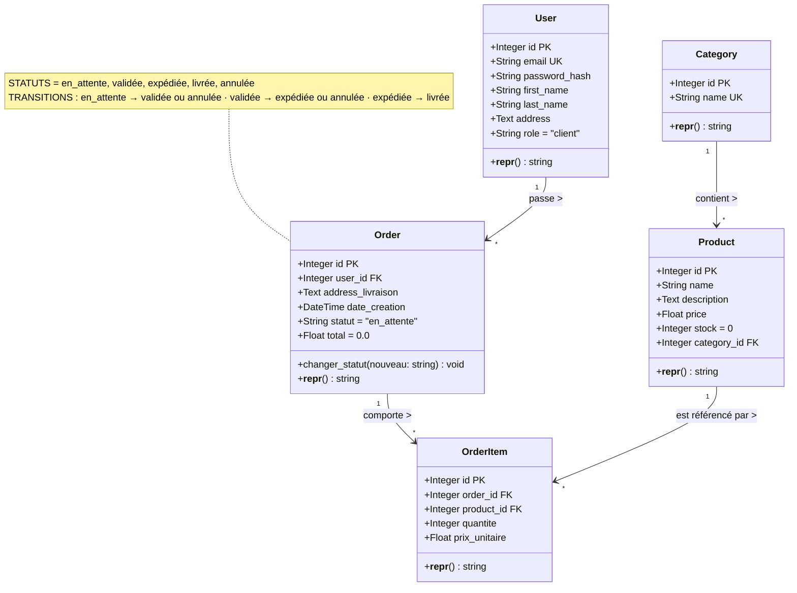
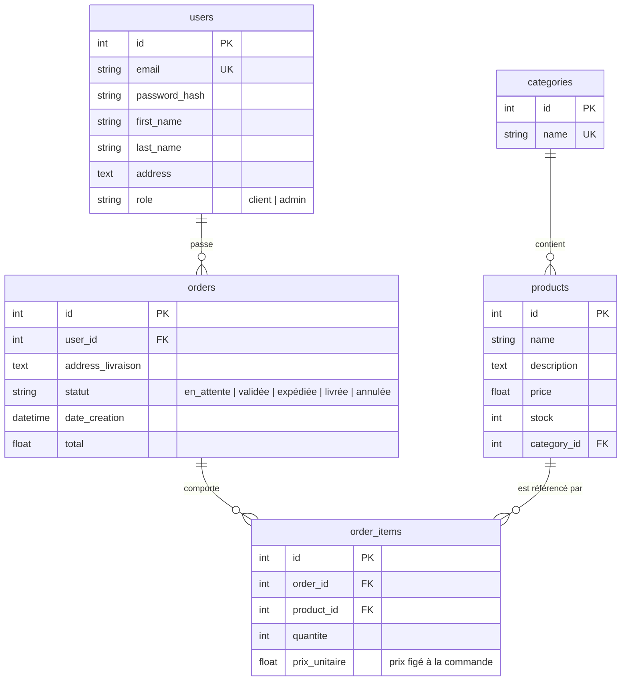
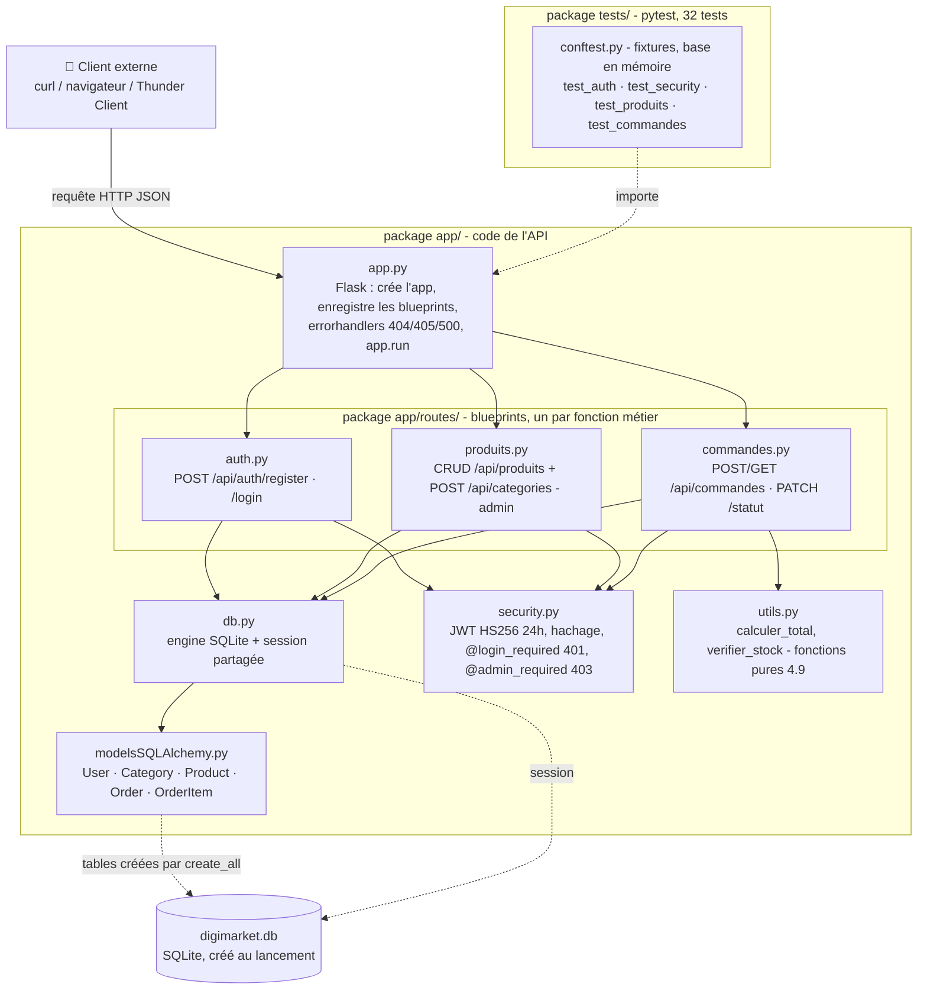
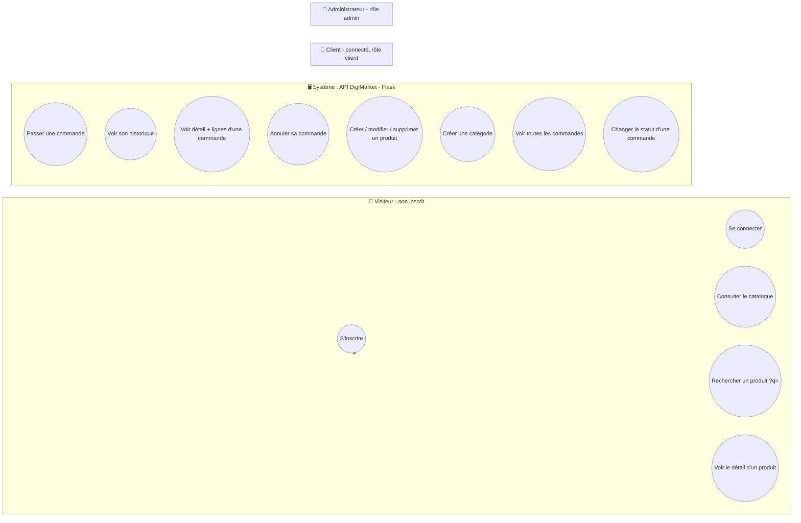
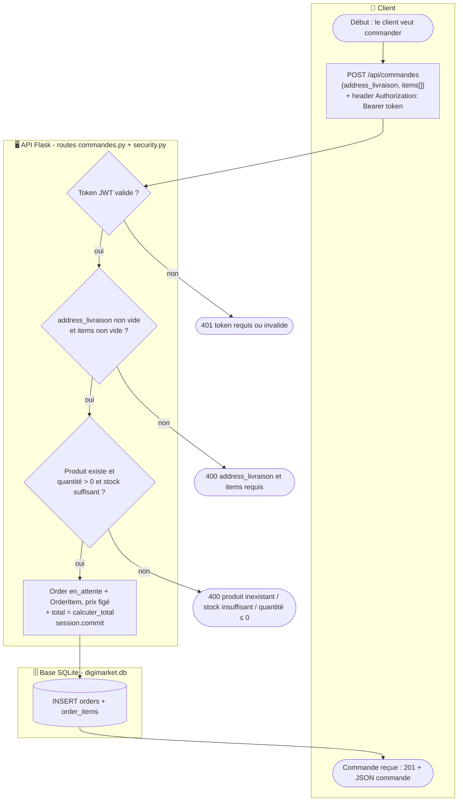
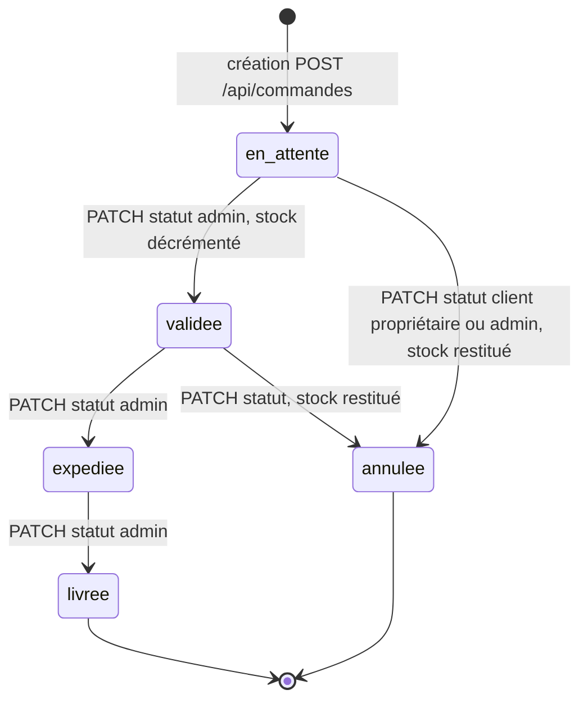
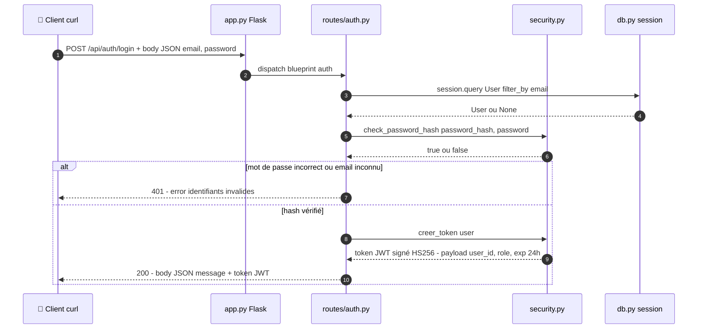
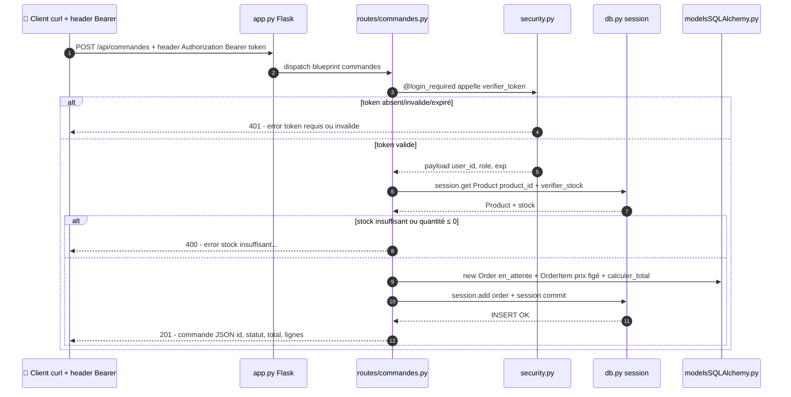
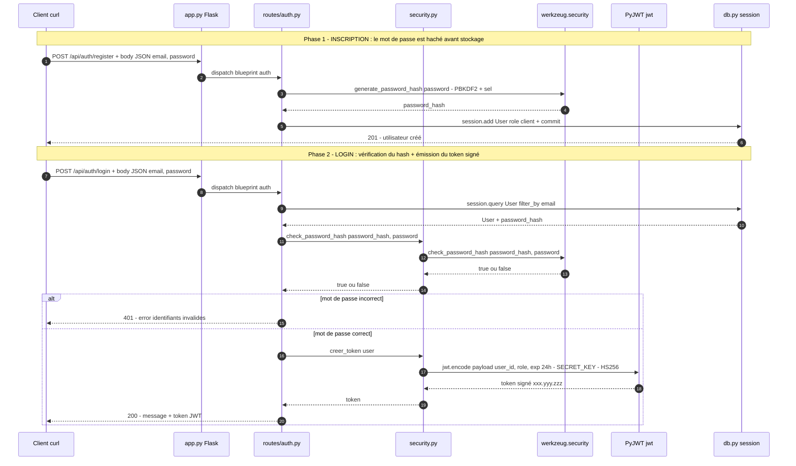
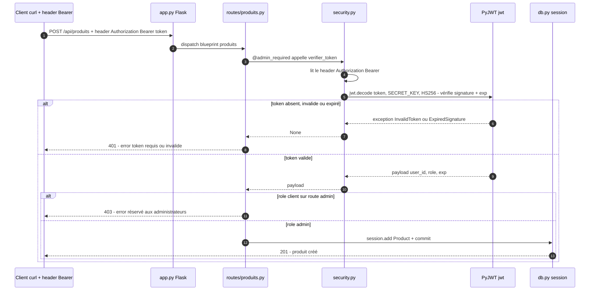

<!-- historique : rendu Mermaid fiabilisé — plus aucune parenthèse dans les étiquettes des diagrammes (commits 6cc61c1, 17f3060) -->

# 📐 Vue UML complète du projet DigiMarket (API Flask)

Ce document regroupe **tous les diagrammes UML du projet**, organisés selon les **3 familles officielles de l'UML** (standard OMG) :

| Famille UML | Question répondue | Diagrammes ici |
|---|---|---|
| 🏗️ **Structure** | *De quoi le système est-il fait ?* (classes, composants, données) | classes, ER, composants/packages |
| ⚙️ **Comportement** | *Comment le système évolue-t-il / s'enchaîne-t-il ?* (cas d'utilisation, activités, états) | cas d'utilisation, activité, machine à états |
| 🔁 **Interaction** | *Qui échange quoi avec qui, et dans quel ordre ?* | 4 séquences |

> 💡 **Pourquoi ce fichier est en `.md`** : GitHub rend automatiquement les blocs ` ```mermaid ` **uniquement dans les fichiers Markdown** (vue fichier, README, onglet « Files changed » d'une PR). Les canva `.mmd` du projet (`canva-*.mmd`) restent du texte brut sur GitHub → rendu via [mermaid.live](https://mermaid.live). Ce doc `.md` est donc la version « rendue nativement sur GitHub ».
>
> 📖 **Légende générale UML utilisée partout ici** : visibilité `+` = public ; `PK` = clé primaire, `FK` = clé étrangère, `UK` = unique ; multiplicités `1`, `*` (plusieurs), `1..*` ; `||--o{` = « un vers zéro-ou-plusieurs » (ER) ; dans une machine à états, `[*]` = état initial/final et `A --> B : événement` = transition déclenchée par l'événement.

---

## 🏗️ Famille 1 — STRUCTURE

### 1.1 Diagramme de classes (UML `classDiagram`) — les 5 modèles ORM

Vue logique orientée objet, fidèle à `app/modelsSQLAlchemy.py` (niveau 🥇). Même contenu que le canva `docs/canva-classes-confirme.mmd`.



**Légende** : chaque boîte = une classe (= une table en base). Le compartiment du milieu liste les attributs avec leur type UML/Python ; `PK`/`UK`/`FK` sont des stéréotypes informels posés en annotation. Les flèches sont des **associations UML** avec multiplicités : un `User` passe zéro-ou-plusieurs `Order`, etc. `Order.changer_statut()` est la méthode métier du cycle de vie (4.6).

### 1.2 Diagramme entité-association (`erDiagram`) — schéma physique de la base SQLite

Même modèle, vu « base de données » : tables réelles de `digimarket.db` (`__tablename__` dans le code).



**Légende** : `users ||--o{ orders` se lit « un utilisateur possède zéro ou plusieurs commandes ». La version « objets métier » (noms français) existe dans `docs/etape3-objets.md` ; celle-ci colle aux vrais noms de tables SQL.

### 1.3 Diagramme de composants / packages — architecture du code

Vue « package UML » : chaque `subgraph` = un package (dossier), les flèches = dépendances (imports / appels).



**Légende** : le client HTTP ne parle qu'à `app.py` (point d'entrée unique) ; `app.py` dispatche vers les blueprints (`routes/*.py`, un par fonction métier F1–F4, exigé par le CDC) ; la sécurité (`security.py`) filtre les routes protégées (401/403) ; tout passe par la session partagée `db.py` pour éviter l'import circulaire ; les modèles ORM sont persistés dans `digimarket.db`. Les tests importent l'app mais utilisent une base en mémoire (jamais `digimarket.db`).

---

## ⚙️ Famille 2 — COMPORTEMENT

### 2.1 Cas d'utilisation (approximation `flowchart`)

> ⚠️ Mermaid ne possède pas de `useCaseDiagram` natif en version stable : on approxime ici le diagramme de cas d'utilisation UML par un flowchart (acteurs en sous-graphes, cas dans la frontière système). Pour un vrai diagramme UML de cas d'utilisation (bonhomme + ellipse), utiliser PlantUML. Acteurs et cas issus de `docs/etape1-use-cases.md`.



**Légende** : en UML pur, chaque acteur serait un bonhomme relié par une ligne à des ellipses (cas) à l'intérieur d'un rectangle « système ». Ici : `Visiteur` peut consulter le catalogue sans compte ; `Client` commande et gère **ses** commandes (règle client_propriétaire, 403 sinon) ; `Admin` gère produits/stocks et **toutes** les commandes.

### 2.2 Diagramme d'activité — scénario « passer une commande » (couloirs)



**Légende** : trois couloirs (Client / API / Base). Toute branche « non » d'un losange se termine par une erreur HTTP en JSON `{"error": ...}` ; seule la branche « tout oui » persiste la commande (201). Le stock n'est **décrémenté** qu'à la validation (voir machine à états ci-dessous), pas à la création.

### 2.3 Machine à états (UML `stateDiagram-v2`) — cycle de vie de `Order.statut`

Fidèle à `Order.TRANSITIONS` dans `app/modelsSQLAlchemy.py` (4.6). Version aussi présente dans `docs/etape3-objets.md`.



**Légende** : `en_attente` est l'état initial (création). (ID d'états sans accents et étiquettes sans caractères spéciaux `→`/`-`, pour compatibilité avec le rendu Mermaid de GitHub.) `livrée` et `annulée` sont finaux (`[*]`). Toute transition hors de ce graphe → `ValueError` → **400** « transition interdite : X → Y ». Un client non admin ne peut déclencher que `annulée` sur **sa** commande (sinon 403).

---

## 🔁 Famille 3 — INTERACTION

### 3.1 Diagramme de séquence — obtention du token (login)



**Légende** : le token n'est émis qu'après vérification du hash du mot de passe ; le `alt/else` UML montre les deux issues (401 ou 200+token).

### 3.2 Diagramme de séquence — requête protégée (ex. POST /api/commandes)



**Légende** : trois `alt` UML imbriqués = les trois niveaux de contrôle (authentification 401 → validation métier 400 → succès 201). C'est exactement le contrat documenté dans `docs/docAPI.md` (chapitre 1).

### 3.3 Diagramme de séquence — `security.py` au centre : Inscription et Login

Phases 1 et 2 : hachage du mot de passe à l'inscription, vérification du hash et émission du token JWT au login (la revérification du token à chaque requête protégée est en §3.4).



**Légende** : à l'inscription le mot de passe est haché via werkzeug (`generate_password_hash`, PBKDF2 + sel) avant stockage ; au login `check_password_hash` compare le hash soumis au hash stocké, puis `creer_token` signe le payload `user_id, role, exp 24h` avec `SECRET_KEY` lu dans `.env` via PyJWT HS256.

### 3.4 Diagramme de séquence — `security.py` au centre : Route protégée

Phase 3 : à **chaque** appel d'une route protégée, le décorateur rappelle `verifier_token` — lecture du header `Authorization: Bearer`, puis décodage PyJWT avec vérification de la signature et de l'expiration.



**Légende** : 401 = pas authentifié (token absent, invalide ou expiré) · 403 = authentifié mais rôle insuffisant. Le rôle est embarqué dans le token signé : un client ne peut pas le modifier. Le token est revérifié à chaque requête — jamais mis en cache côté serveur.

---

## 📋 Tableau récapitulatif

| Famille UML | Diagramme | Bloc Mermaid | Fichier source / référence |
|---|---|---|---|
| Structure | classes | `classDiagram` | §1.1 = `app/modelsSQLAlchemy.py` + `docs/canva-classes-confirme.mmd` |
| Structure | entité-association | `erDiagram` | §1.2 = tables de `digimarket.db` (`docs/etape3-objets.md`) |
| Structure | composants/packages | `flowchart` (subgraphs) | §1.3 = arborescence `app/` (`docs/canva-structure-confirme.mmd`) |
| Comportement | cas d'utilisation | `flowchart` (approx.) | §2.1 = `docs/etape1-use-cases.md` |
| Comportement | activité « passer une commande » | `flowchart` (couloirs) | §2.2 = `routes/commandes.py` + `docs/demo.md` |
| Comportement | machine à états `Order.statut` | `stateDiagram-v2` | §2.3 = `Order.TRANSITIONS` (`modelsSQLAlchemy.py`) |
| Interaction | séquence login → token | `sequenceDiagram` | §3.1 = `routes/auth.py` + `security.py` |
| Interaction | séquence requête protégée | `sequenceDiagram` | §3.2 = `routes/commandes.py` + contrat `docs/docAPI.md` |
| Interaction | séquence security.py - inscription et login | `sequenceDiagram` | §3.3 = `app/security.py` + werkzeug + PyJWT + `routes/auth.py` |
| Interaction | séquence security.py - route protégée 401, 403 | `sequenceDiagram` | §3.4 = `app/security.py` + PyJWT + `routes/produits.py` |

> 💡 Pour la démo orale : projeter §1.1 (structure), §2.3 (machine à états) et §3.3/§3.4 (séquences security.py) — ce sont les diagrammes UML les plus parlants pour expliquer le fonctionnement de l'API.
